# Wood visual concepts

Four optional looks for the Wood planet (stages 1–12). The tilt rules, walls, levels, and the other planets stay as they are. With no `look` param the board is the shipped game.

| Look | Open |
| --- | --- |
| Diorama | `?look=diorama` |
| Pixel | `?look=pixel` |
| Clay | `?look=clay` |
| Neon | `?look=neon` |

Stage links still use the hash. Wood 1 is `#1`. Wood 8 is `#8`.

```
https://hun0823.github.io/Game-Inthehole/?look=diorama#1
https://hun0823.github.io/Game-Inthehole/?look=pixel#1
https://hun0823.github.io/Game-Inthehole/?look=clay#1
https://hun0823.github.io/Game-Inthehole/?look=neon#1
```

Wood 8 is the same URL with `#8`. GitHub Pages publishes `main` only. Before that merge, serve this branch from the repo root:

```
python3 -m http.server 8080
```

Then open `http://127.0.0.1:8080/?look=diorama#1`. `look`, `fps`, and `perf` stay in the address bar when the stage changes. The skin applies only while the planet is Wood, and the kit is not downloaded on any other planet.

## What each look changes

Pixel, clay, and neon keep the shipped camera (elevation 82°, fov 28). Diorama, on Wood only, uses a three-quarter camera at 46° from horizontal and fov 34, so the board reads as a thick island. The HUD boxes do not move. Each look hides the stock frame and draws its own board from a Blender kit. Cells, walls, and the hole stay on the same grid. The ball still stops on the grid, not on the mesh.

**Diorama.** A thick grass island with a rounded wood rim (`#8D6E4C`), grass tiles (`#7CB342`), and dark wood walls (`#6D4C41`). The honey ball (`#E0A04A`) and the dug hole (inside `#3E2723`, rim `#C9842A`) are a set. The island sits on a grass hill with two trees behind it, under a warm sky (`#F7E8C8` to `#E8F2F0`). A standing squirrel waits at the front-left, facing the camera, and idles with a blink and a tail sway. The island tilts with the input. The squirrel, hill, and trees stay upright. A wall stop still squashes the ball, and the hole lets off a small dust puff.

**Pixel.** Hard cubes, a stepped block rim, brick walls, a square pit, and a banded voxel ball. The squirrel is a stack of cubes with a block tail. The sky is a banded night with a small pixel sun. No post pass.

**Clay.** Bevelled cushion tiles in a tray with a bead rim, capsule walls, a terracotta well, and a faceted clay ball. The squirrel is a huge-headed chibi. Trees are blobs and a topiary.

**Neon.** Dark plates with glowing borders, a thin rail for each wall, a magenta ring around the hole, and a ringed ball. The squirrel is a dark slab with a cyan stripe and a thick zigzag tail. Colors are unlit vertex colors, so the rails read without a bloom pass.

Glass, gates, and magma hooks are still the existing meshes. Wood stages do not use them.

## Art

Meshes are original, authored in Blender 4.5.16 LTS by `tools/blender/build_looks.py`, then meshopt-compressed with gltfpack (`-c -kn -kv`). Lighting and ambient occlusion are baked into vertex colors. There are no KTX2 or WebP textures on the kits; a transcoder would have been larger than the meshes. Licenses are in `CREDITS.md`.

| Piece | Diorama tris | Pixel tris | Clay tris | Neon tris |
| --- | ---: | ---: | ---: | ---: |
| Tiles (3) | 324 | 84 | 324 | 180 |
| Wall | 108 | 48 | 156 | 48 |
| Rim + corners | 300 | 96 | 208 | 176 |
| Ball + goal | 412 | 172 | 316 | 416 |
| Squirrel | 1060 | 192 | 400 | 240 |
| Trees + props | 380 | 192 | 388 | 310 |
| Ground + hill | 548 | 2 | 2 | 2 |
| **Kit total** | **3132** | **786** | **1794** | **1372** |

The diorama island does not place the rim pieces; the thick ground is the rim. Those meshes stay in the file. GLB size on disk: diorama 71.5 KB, pixel 24.6 KB, clay 47.5 KB, neon 34.8 KB. All four together are 174 KB. Only the selected kit is fetched.

Gzip of what a first visit downloads when that look is selected (the look module, shared kit, sky, GLTFLoader, meshopt decoder, and the GLB):

| Look | Gzip |
| --- | ---: |
| Diorama | 74 KB |
| Pixel | 42 KB |
| Clay | 57 KB |
| Neon | 48 KB |

`js/woodLook.js` is about 0.5 KB gzip and loads with every visit. It does not import a look or a GLB until a Wood stage is opened with `?look=` set.

## Performance

Measured in headless Chromium with an iPhone user agent, a 430×932 viewport, device scale 2, and SwiftShader (`ANGLE (Google, Vulkan 1.3.0 (SwiftShader Device (Subzero) (0x0000C0DE)), SwiftShader driver)`). This is not WebKit and not a phone. Do not read these numbers as iPhone frame rate.

| Scene | fps | frame p50 / p95 | draws | triangles |
| --- | ---: | --- | ---: | --- |
| Shipped Wood 1 | 9 | 117 / 117 ms | 56 | 17k |
| Diorama Wood 1 | 20 | 33 / 217 ms | 17 | 3.5k |
| Pixel Wood 1 | 27 | 33 / 67 ms | 24 | 1.6k |
| Clay Wood 1 | 25 | 33 / 67 ms | 24 | 3.9k |
| Neon Wood 1 | 27 | 33 / 67 ms | 25 | 2.7k |
| Diorama Wood 8 | 31 | 33 / 50 ms | 17 | 7.3k |
| Neon Wood 8 | 26 | 33 / 67 ms | 25 | 5.7k |

The looks are MeshBasic vertex colors with instanced tiles and walls. They hide the stock frame instead of drawing it again, and they do not add a fullscreen pass.

## Rules

The looks do not change the tilt solver. `python3 tools/validate_levels.py` reports 132 stages solvable and par matching BFS. `js/game.js` and `shared/levels.json` are not part of this change. After the diorama camera change, the same Wood 1 solution (left, up, left, down) still reaches 4/4 and the same Wood 8 solution (left, up, right, down, right, up, right, down) still reaches 8/8, played with the D-pad.

## Stills

430×932. These files are documentation. The game does not request them.

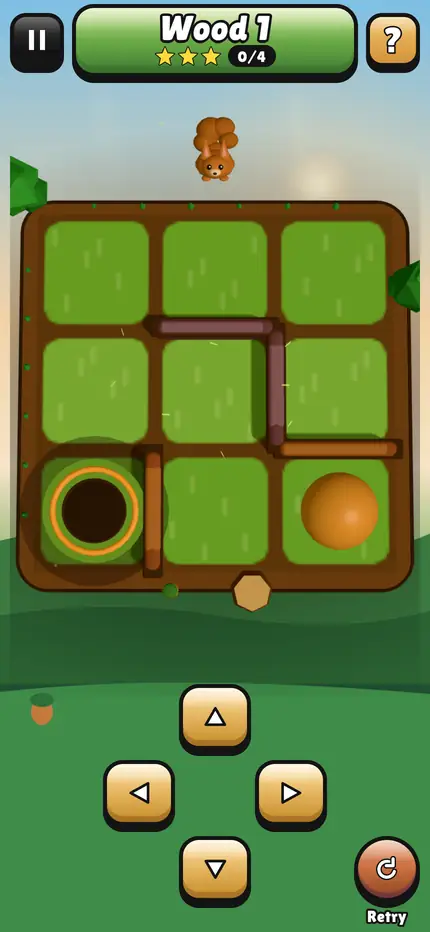
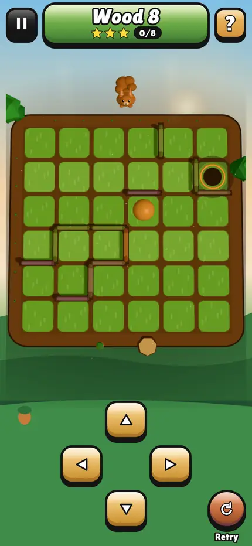
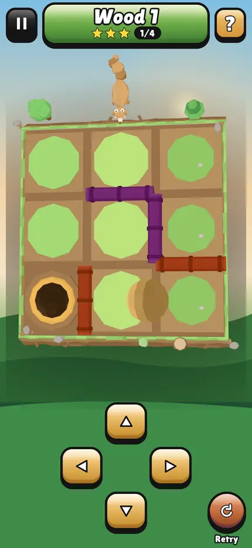

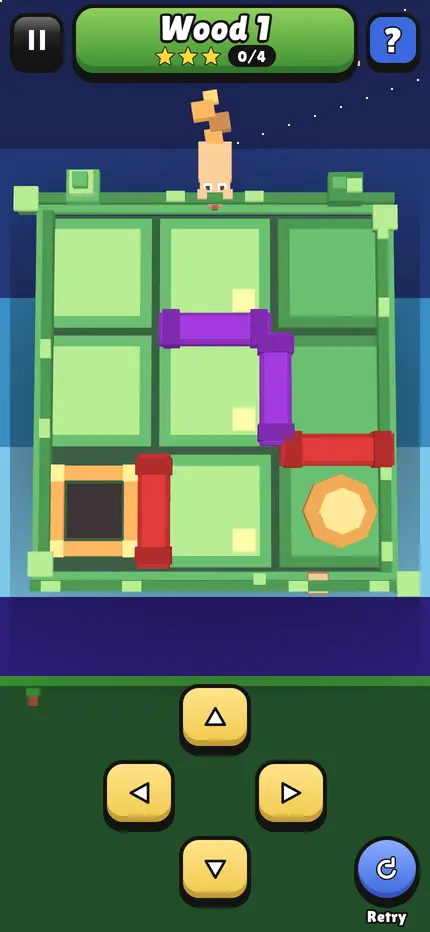
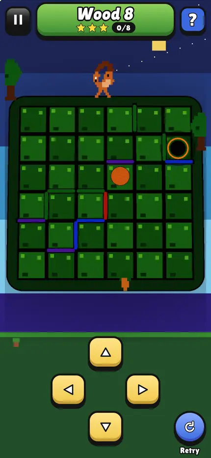
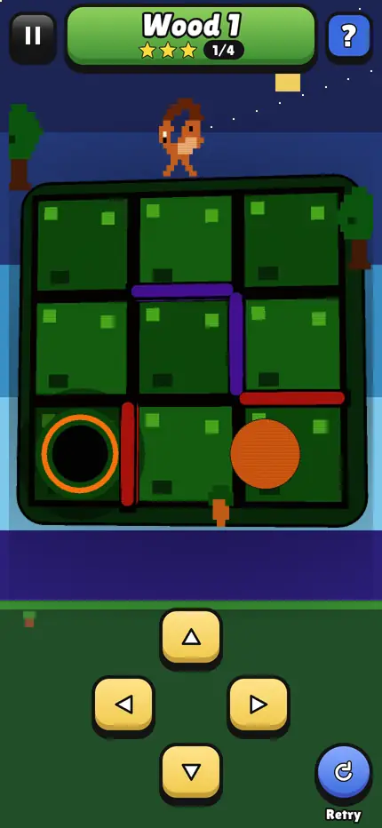

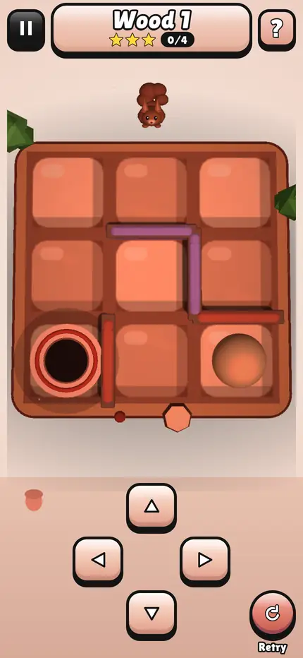
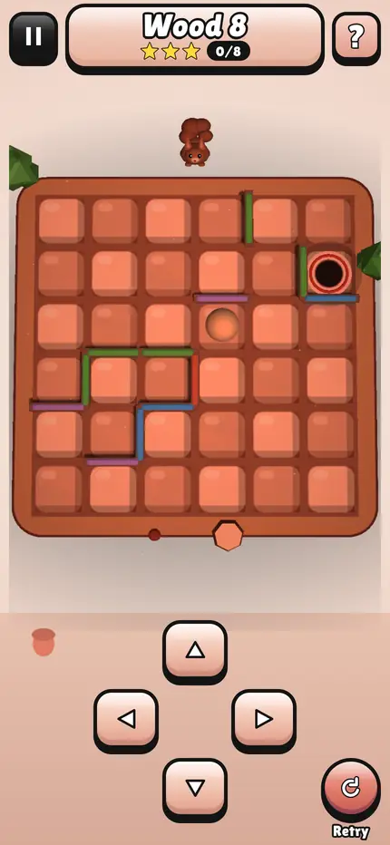
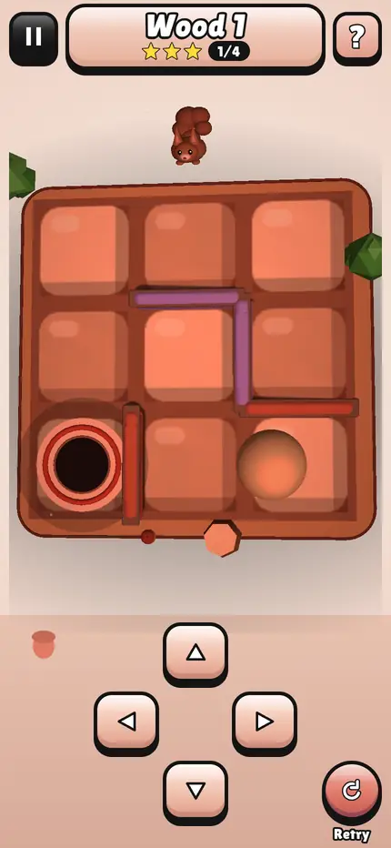

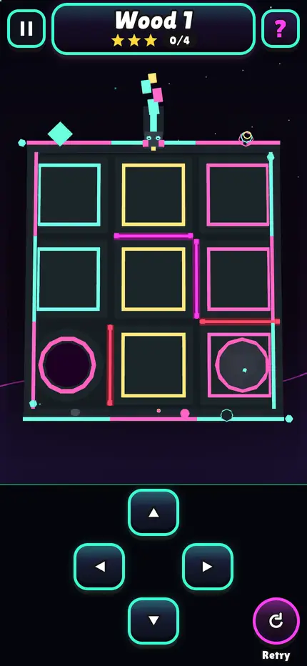
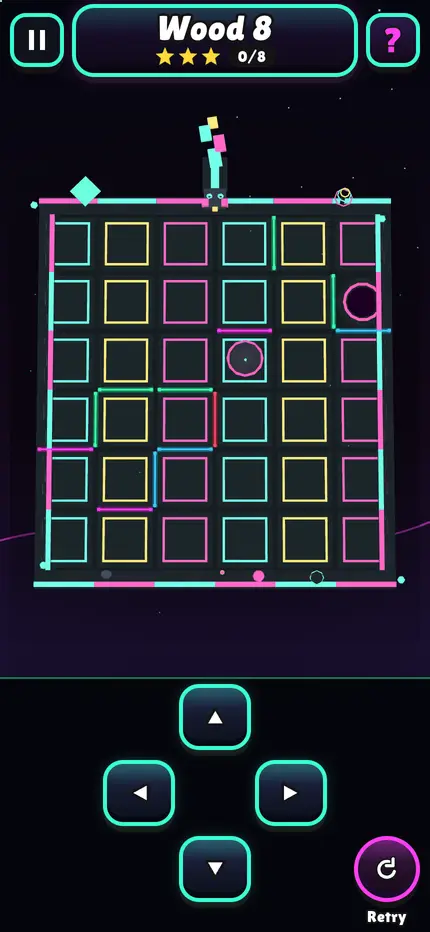
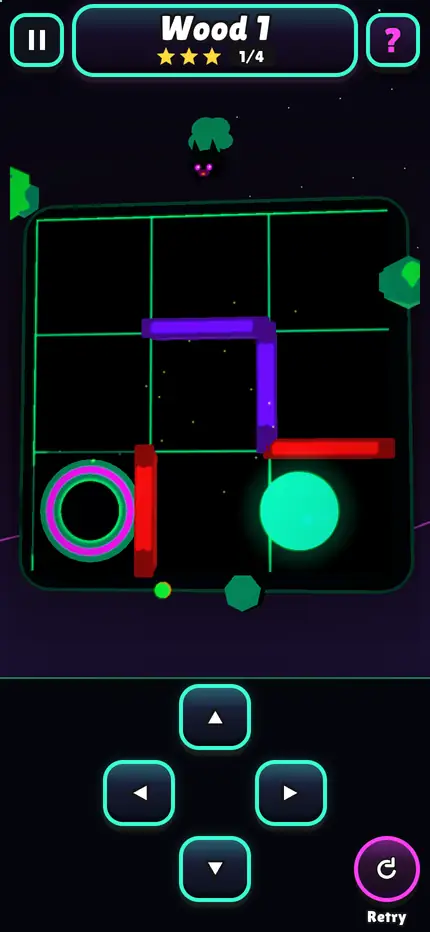
